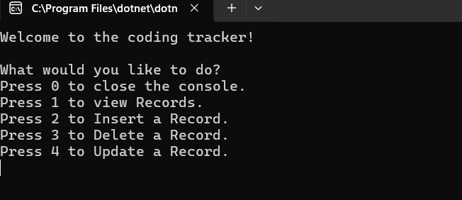
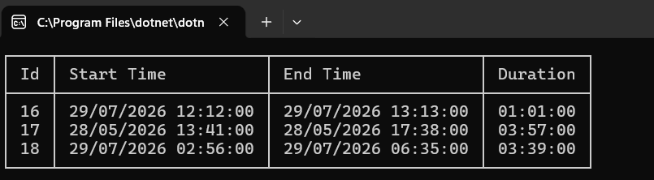
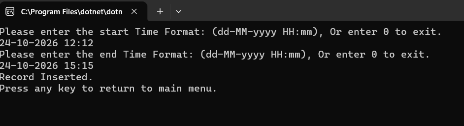
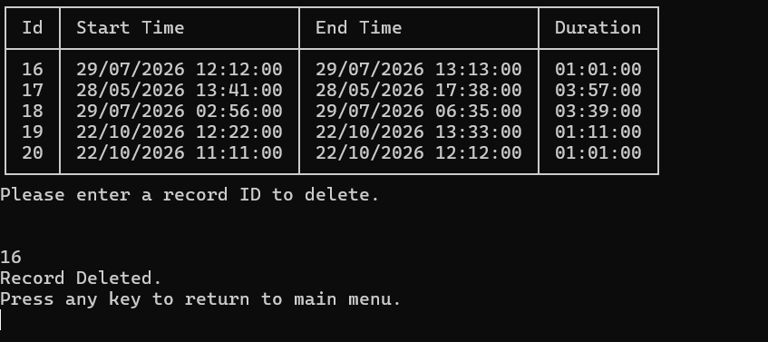
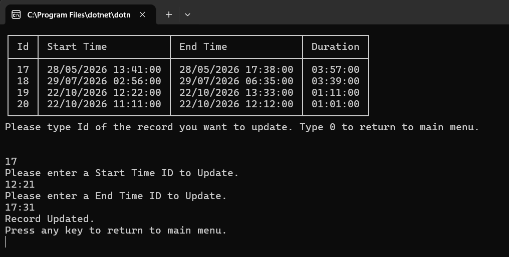

# Coding Tracker


The coding tracker is a C# console application I'm building to log and manage the duration of code sessions.

I built this as part of the C# Academy curriculum.


## What it does:

Log coding sessions with a start time, end time, and auto calculated duration including date

View all sessions in a formatted table

Insert, update, and delete and view created sessions

Input validation enforcing a strict date/time format


## How to run

### Prerequisites

- [.NET 10 SDK](https://dotnet.microsoft.com/download)

### Steps

```bash
git clone https://github.com/jcisco22/CodeReviews.Console.CodingTracker.git
cd CodeReviews.Console.CodingTracker/Coding-Tracker/Coding-Tracker
dotnet run
```

The database file is created automatically on first run.


## Tech stack:

C# — .NET 10 console app

SQLite — local file based database, packaged as Microsoft.Data.Sqlite

Dapper — Object relational mapper used for mapping query results to C# objects

Spectre.Console — Used to create visually appealing tables in the formatted table output in the terminal


## How it works:

When running the program the user will be greeted with a menu.

The menu presents the user with five options shown in the image below with the first option being to close the program.

The rest of the options are Create Read Update and Delete operations labelled from 1 - 4.





The First CRUD operation is to view the coding tracker records:

The table consists of the four properties Id, Start Time, End Time and Duration.




The second CRUD operation is to insert a record:

The insert menu asks a user to enter a start and end time in the format provided including the date.

If successfully inserted, a message showing the record was inserted is shown, followed by a return to the main menu option.




The third CRUD operation is to delete a record:

The program shows a list of the records in the database and prompts the user to enter the id number of the record to delete.

If successfully deleted, a message showing the record was deleted is shown, followed by a return to the main menu option.




The fourth and final operation is the update record feature:

The program prompts the user to enter the id of the record they'd like updated then asks the user to enter a new start and end time.

If successfully updated, a message showing the record was updated is shown, followed by a return to the main menu option.




## Project structure:


Program.cs is the entry point, it creates the table and starts the menu by calling the CreateTable method which lives in CodingController and the GetUserInput method which lives in the UserInput class.

CodingSession.cs is the model, it holds the properties used throughout the program, it mirrors the database table.

CodingController.cs is for database operations, all CRUD methods live inside this class, Dapper is used to execute the raw SQLite queries.

UserInput.cs is for user interaction, this class contains the switch menu, input collection methods and contains methods that call the CodingController class.

Validation.cs is for input validation, this class holds the ValidateTime, ValidateId and ValidateEndTime methods used for date format and ID validation.

appsettings.json is for configuration, this file stores the database connection string.


## Separation of concerns

Each class has one job.

This is the first time I used classes in a program, the project requirements made separation of concerns a must for this project.

I decided to split the program into four main classes:


UserInput talks to the user, displays menus, collects input, calls controller methods.

CodingController talks to the database, receives parameters, runs SQL.

Validation checks input. When input is invalid, it shows an error message and asks the user to try again.

CodingSession is the model, containing the properties used throughout the program.


## Database Layout:


The table is created on startup if it does not already exist:


````
CREATE TABLE IF NOT EXISTS coding_tracker (
Id INTEGER PRIMARY KEY AUTOINCREMENT,
StartTime TEXT,
EndTime TEXT,
Duration TEXT
)

````

Id is of type INTEGER, this is the primary key of the data, it is set to auto-increment.


StartTime is of type TEXT, the format of the start time is dd-MM-yyyy HH:mm.


EndTime	is of type TEXT, it follows the same format of StartTime which is dd-MM-yyyy HH:mm.


Duration is calculated as EndTime - StartTime, which gives a TimeSpan. SQLite has no built in DateTime or TimeSpan types, so the duration is converted to a string and stored as TEXT.


Dates are stored as strings and parsed in C#. 


## Duration calculation:

Duration is not entered by the user. Subtracting one DateTime from another gives a TimeSpan which is converted to a string before being stored in SQLite:

```
string duration = (endTime - startTime).ToString();
```

## Validation:

Date input is validated with DateTime.TryParseExact, enforcing the format "dd-MM-yyyy HH:mm".

The ValidateTime method ensures that the user enters the correct format by looping until the correct format is received:


```
    public static DateTime ValidateTime(string getTime)
    {
        DateTime result;
           
        while (!DateTime.TryParseExact(getTime, "dd-MM-yyyy HH:mm", null, DateTimeStyles.None, out result))
        {
            Console.WriteLine("Invalid format. Try again (dd-MM-yyyy HH:mm): ");
            getTime = Console.ReadLine();
        }

        return result;
    }
```

ID input is validated with int.TryParse, rejecting non numeric input and values less than or equal to zero.

## End time validation:

ValidateEndTime was added after code review pointed out that an end time could be earlier than the start time, producing a negative duration. It takes the already-validated start time and uses a while loop to keep asking for an end time until it is later than the start, preventing zero or negative durations.


```
    public static DateTime ValidateEndTime(DateTime startTime)
    {
        DateTime endTime = ValidateTime(Console.ReadLine());

        while (endTime <= startTime)
        {
         Console.WriteLine("End time must be after start time.\nPlease try again (dd-MM-yyyy HH:mm): ");
         endTime = ValidateTime(Console.ReadLine());
        }

        return endTime;
    }

```


## Rows affected: 

connection.Execute returns the number of rows affected. Used to detect when a user enters an ID that does not exist:


```
int rowsAffected = connection.Execute(sql, parameters);
if (rowsAffected == 0)
    Console.WriteLine("No record found with that ID.");
```


## Key concepts:

### Dapper:

Dapper sits on top of ADO.NET and removes the need to manually map database columns to the properties.

connection.Query<CodingSession>(sql) — runs a SELECT and maps each row to a CodingSession object.

connection.Execute(sql, parameters) — runs INSERT, UPDATE, DELETE operations.

Parameters are passed as anonymous objects and being assigned value: new { Id = id, StartTime = startTime }.

The property names on the anonymous object must match the @placeholder names in the SQL exactly or values won't be passed over and values will be null.


### Connection string:

The database connection string is stored in appsettings.json rather than being hardcoded. This keeps configuration separate from code, so the database location can be changed without editing or recompiling the program.


```
{
  "ConnectionStrings": {
    "DefaultConnection": "Data Source=Coding-Tracker.db"
  }
}
```

### Reading the connection string

The connection string needed to access the database is read into a static field using ConfigurationBuilder:


```
static string connectionString = new ConfigurationBuilder()
    .AddJsonFile("appsettings.json")
    .Build()
    .GetConnectionString("DefaultConnection")
    ?? throw new InvalidOperationException("Connection string not found.");
```

If the connection string is missing, GetConnectionString returns null. The ?? operator then throws an exception with a not found message so the program fails immediately instead of hitting a confusing null error later.


### Copying appsettings.json to the build output

```
<ItemGroup>
  <None Update="appsettings.json">
    <CopyToOutputDirectory>Always</CopyToOutputDirectory>
  </None>
</ItemGroup>
```
This configuration in the .csproj file ensures that appsettings.json is copied to the build output directory whenever the project is built. This is necessary because the application needs to access the file at runtime to retrieve the database connection string. Without the file in the output directory, the application may be unable to load its configuration.


## Reflection:

When initially submitting my project for review, my project could not be approved due to an error with the Duration field. I had correctly calculated and stored the duration when a record was being inserted but the update method would only update the StartTime and EndTime fields leaving out duration which is the thing we are actually tracking. This meant the record could contain an outdated duration after an update. To fix this issue I added duration as a parameter to the update method and included it in the SQL UPDATE statement. This ensures that StartTime, EndTime and Duration are all updated together when a record is modified.


I prematurely committed the program before verifying the issue had been resolved, after running the program I realised that it hadn't. After updating a record and viewing it I noticed that the duration column was still missing as I hadn't updated the UpdateInput method in the UserInput class to assign the duration field the result of EndTime minus StartTime which I did with the line string duration = (endTime - startTime).ToString(); converting it to string as duration is stored as string. After adding this line I ran the program without this issue.

The second issue returned from my code review was end time could be earlier than start time which is a clear problem as it would be calculated as a negative duration. To solve this issue I created a new validation method called ValidateEndTime. The method starts by creating a local variable named endTime and assigning it the value of the ValidateTime method which checks that the user’s input is in the correct format. ValidateEndTime receives the start time as a DateTime parameter, which is used to compare against the end time. A while loop checks whether the end time is earlier than or equal to the start time; if it is, the user is shown an error message and asked to enter the end time again. The loop repeats until a valid end time is entered, and the method then returns it. The insert menu applies the same check inside InsertInput, so the user can still enter 0 to exit.

Overall I think the project taught me a lot, mainly about separation of concerns as well as validation and what ORMs are by using Dapper. I gained a better understanding of how separating input logic from database operations makes code easier to maintain, and how validation helps prevent invalid records from being stored and even accepted. I also learned how Dapper simplifies database interactions by mapping query results to C# objects and allowing SQL queries to be executed directly from the application.

Refactoring for the time propmts was a little different as the ValidateTime and ValidateEndTime methods return types were DateTime, returning 0 wasnt an option here. I needed a value that could mean nothing, so I changed ValidateTime and ValidateEndTime to return a nullable DateTime?. If the user enters 0, these methods return null, and InsertInput and UpdateInput return to the main menu when they receive it. While making this change, I also removed a call to GetUserInput from GeTimeInput, which had been opening a new menu on top of the existing one. Changing the DateTime methods to DateTime? in the validation class meant i had to do it throughout the program.Lastly I updated InsertInput to use ValidateEndTime instead of its own copy of the end time check.


## Limitations :

As duration is stored as text, calculations like "total hours coded this week" can’t be calculated in SQLite.

Some CodingController methods write directly to the console. The messages are needed, but displaying them is UserInput’s job, so this breaks separation of concerns. A cleaner design would return a result and let UserInput show the message.


